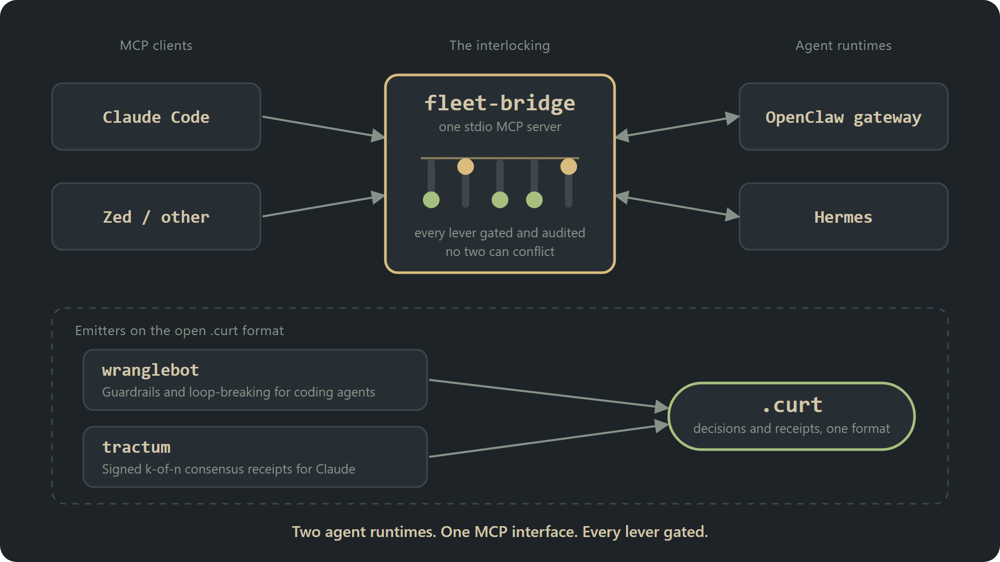

<div align="center">
  
</div>

Agent infrastructure for people running agents that do real work —
bridging, guardrails, verifiable consensus, and a signal box to watch it all.

**Two agent runtimes. One MCP interface. One signal box. Every lever gated.**

[](https://github.com/leverframe/fleet-bridge/actions/workflows/ci.yml)
[](https://github.com/leverframe/fleet-bridge/actions/workflows/gitleaks.yml)
[](https://github.com/leverframe/fleet-bridge/blob/main/LICENSE)
[](https://docs.leverframe.dev)

Leverframe is named for the railway signal box: an interlocking where
every lever is mechanically prevented from conflicting with any other.
The tools here apply that discipline to agent fleets — deterministic
guardrails, signed consensus receipts, one audited bridge between your
MCP clients and your agent runtimes, and a read-only panel that shows
you the whole board.

<table>
  <tr>
    <td width="50%" align="center" valign="top">
      <br>
      <a href="https://github.com/leverframe/fleet-bridge"></a><br><br>
      <a href="https://github.com/leverframe/fleet-bridge"><strong>fleet-bridge</strong></a><br>
      <sub>One stdio MCP server bridging <strong>OpenClaw</strong> and <strong>Hermes</strong> agents<br>into any MCP client — cross-runtime by construction.</sub><br><br>
      <a href="https://github.com/leverframe/fleet-bridge/blob/main/LICENSE"></a>
      <a href="https://www.npmjs.com/package/fleet-bridge"></a>
    </td>
    <td width="50%" align="center" valign="top">
      <br>
      <a href="https://github.com/leverframe/cabinet-lite"></a><br><br>
      <a href="https://github.com/leverframe/cabinet-lite"><strong>cabinet-lite</strong></a><br>
      <sub>The signal box made software: a read-only fleet dashboard —<br>what needs you, who's free, what happened.</sub><br><br>
      <a href="https://github.com/leverframe/cabinet-lite/blob/main/LICENSE"></a>
      <a href="https://docs.leverframe.dev"></a>
    </td>
  </tr>
  <tr>
    <td width="50%" align="center" valign="top">
      <br>
      <a href="https://github.com/leverframe/wranglebot"></a><br><br>
      <a href="https://github.com/leverframe/wranglebot"><strong>wranglebot</strong></a><br>
      <sub>Deterministic guardrails, loop-breaking, and <code>.curt</code> emission<br>for coding agents (Claude Code, Codex).</sub><br><br>
      <a href="https://github.com/leverframe/wranglebot/blob/main/LICENSE"></a>
      <a href="https://wranglebot.com"></a>
    </td>
    <td width="50%" align="center" valign="top">
      <br>
      <a href="https://github.com/leverframe/tractum"></a><br><br>
      <a href="https://github.com/leverframe/tractum"><strong>tractum</strong></a><br>
      <sub>Verifiable multi-agent consensus for Claude —<br>signed k-of-n receipts bound to transcript evidence.</sub><br><br>
      <a href="https://github.com/leverframe/tractum/blob/main/LICENSE"></a>
      <a href="https://tractum.dev"></a>
    </td>
  </tr>
</table>

### How it fits

<p align="center">
  
</p>


Ecosystem: wranglebot and tractum are emitters of the open
[`.curt`](https://github.com/dotcurt/dot_curt) conversation format —
the decision record and the consensus receipt ride in the same file
format as everything else. Per-product reference for the whole stack
lives at **[docs.leverframe.dev](https://docs.leverframe.dev)**.

## Licensing

Per-repo, stated plainly. The fleet-operations core — the bridge and
the signal box — is **MIT**: take it, run it, fork it. WrangleBot and
Tractum are source-available under
[BUSL-1.1](https://spdx.org/licenses/BUSL-1.1.html): free for personal
and noncommercial production use; commercial use requires a written
license from the Licensor. Both convert to MIT in 2030.

## Get started

Bridge your agents (no clone needed):

```bash
npm install -g fleet-bridge
```

Five minutes to your first bridged agent: the
[quickstart](https://github.com/leverframe/fleet-bridge/blob/main/docs/QUICKSTART.md).

Then stand up the signal box — point
[cabinet-lite](https://github.com/leverframe/cabinet-lite#quickstart)
at the same roster files and watch the board.
