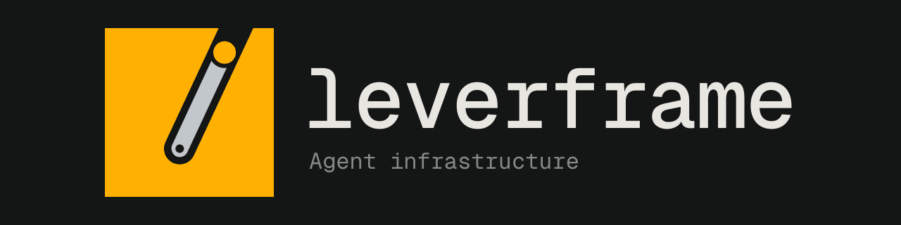
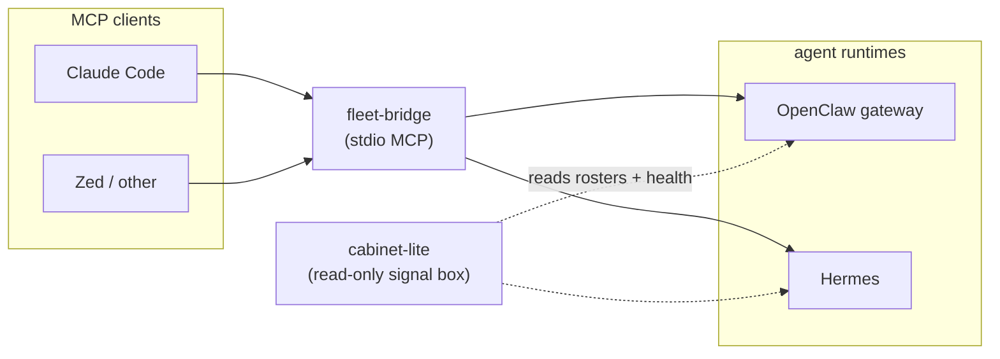

<div align="center">
  
</div>

Agent infrastructure for people running agents that do real work —
bridging, guardrails, verifiable consensus, and a signal box to watch it all.

**Two agent runtimes. One MCP interface. One signal box. Every lever gated.**

[](https://github.com/leverframe/fleet-bridge/actions/workflows/ci.yml)
[](https://github.com/leverframe/fleet-bridge/actions/workflows/gitleaks.yml)
[](https://github.com/leverframe/fleet-bridge/blob/main/LICENSE)
[](https://docs.leverframe.dev)

Leverframe is named for the railway signal box: an interlocking where
every lever is mechanically prevented from conflicting with any other.
The tools here apply that discipline to agent fleets — deterministic
guardrails, signed consensus receipts, one audited bridge between your
MCP clients and your agent runtimes, and a read-only panel that shows
you the whole board.

| Project | What it does | License |
|---|---|---|
| [fleet-bridge](https://github.com/leverframe/fleet-bridge) | One stdio MCP server that bridges OpenClaw gateway agents **and** Hermes agents into any MCP client — cross-runtime by construction. On npm as [`fleet-bridge`](https://www.npmjs.com/package/fleet-bridge). In daily production use on a multi-agent fleet. | [MIT](https://github.com/leverframe/fleet-bridge/blob/main/LICENSE) |
| [wranglebot](https://github.com/leverframe/wranglebot) | Deterministic guardrails, loop-breaking, and `.curt` emission for coding agents (Claude Code, Codex) — [wranglebot.com](https://wranglebot.com) | [BUSL-1.1](https://github.com/leverframe/wranglebot/blob/main/LICENSE) |
| [tractum](https://github.com/leverframe/tractum) | Verifiable multi-agent consensus for Claude — signed k-of-n receipts bound to transcript evidence — [tractum.dev](https://tractum.dev) | [BUSL-1.1](https://github.com/leverframe/tractum/blob/main/LICENSE) |
| [cabinet-lite](https://github.com/leverframe/cabinet-lite) | The signal box made software: a read-only fleet dashboard for OpenClaw, Hermes, and MCP — what needs you, who's free, what happened. | [MIT](https://github.com/leverframe/cabinet-lite/blob/main/LICENSE) |

**Docs**: [docs.leverframe.dev](https://docs.leverframe.dev) — per-product reference for the whole stack.

### How it fits



Ecosystem: wranglebot and tractum are emitters of the open
[`.curt`](https://github.com/dotcurt/dot_curt) conversation format —
the decision record and the consensus receipt ride in the same file
format as everything else.

## Licensing

Per-repo, stated plainly. The fleet-operations core — the bridge and
the signal box — is **MIT**: take it, run it, fork it. WrangleBot and
Tractum are source-available under
[BUSL-1.1](https://spdx.org/licenses/BUSL-1.1.html): free for personal
and business production use; the only carve-out is reselling the work
as a substitute.

## Get started

Bridge your agents (no clone needed):

```bash
npm install -g fleet-bridge
```

Five minutes to your first bridged agent: the
[quickstart](https://github.com/leverframe/fleet-bridge/blob/main/docs/QUICKSTART.md).

Then stand up the signal box — point
[cabinet-lite](https://github.com/leverframe/cabinet-lite#quickstart)
at the same roster files and watch the board.
